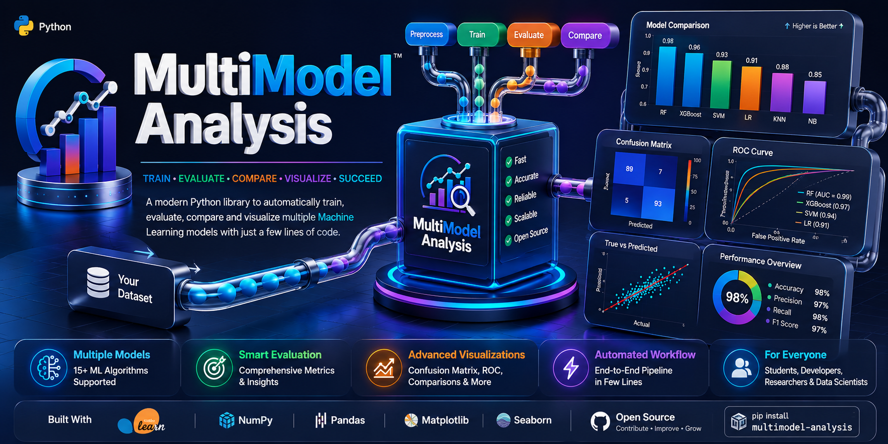

# MultiModel Analysis

<p align="center">
  
</p>

<p align="center"><a href="https://pypi.org/project/multimodel-analysis/"></a> <a href="https://pypi.org/project/multimodel-analysis/"></a> <a href="https://github.com/udityamerit/Multimodel-Analysis-Pacakge/actions/workflows/tests.yml"></a> <a href="https://pepy.tech/project/multimodel-analysis"></a> <a href="LICENSE"></a></p>

**One line of code runs many scikit-learn models on your data and tells you which one is best.**

MultiModel Analysis trains a whole family of models side by side, scores them on the same split, and
gives you a ranked table, clean plots and a one-file HTML report. It covers both halves of machine
learning:

| You have... | Use | What you get |
|---|---|---|
| a target to predict (a category) | `MultiModelClassifier` | Accuracy, F1, ROC-AUC, confusion matrices |
| a target to predict (a number) | `MultiModelRegressor` | MAE, RMSE, R², true-vs-predicted plots |
| no target, want groups | `MultiModelClusterer` | Silhouette, ARI, cluster profiles, best *k* |
| no target, want the odd rows | `MultiModelAnomalyDetector` | anomaly flags, scores, model agreement |
| too many columns | `MultiModelReducer` | 2-D maps, variance kept, trustworthiness |

Every class works the same way, so once you know one you know all five.

## Install

```bash
pip install multimodel-analysis
```

Python 3.10 or newer. Optional extras:

```bash
pip install "multimodel-analysis[boost]"   # XGBoost, LightGBM, CatBoost
pip install "multimodel-analysis[umap]"    # UMAP for dimensionality reduction
pip install "multimodel-analysis[excel]"   # save reports as .xlsx
```

## Your first run (30 seconds)

```python
from sklearn.datasets import load_breast_cancer
from multimodel_analysis import MultiModelClassifier

data = load_breast_cancer(as_frame=True)
clf = MultiModelClassifier(data.data, data.target, random_state=0)

models = clf.run_all_models()           # trains every standard model
clf.show_tabular_report(models)         # ranked table + the recommended model
clf.plot_comparison(models)             # one clean ranked bar chart
```

Messy data (missing values, text columns)? Add `preprocess=True` and it is handled for you.

## The same pattern for everything

```python
from multimodel_analysis import (
    MultiModelClassifier, MultiModelRegressor,
    MultiModelClusterer, MultiModelAnomalyDetector, MultiModelReducer,
)

# 1. build it with your data
tool = MultiModelClusterer(X, n_clusters=3, random_state=0)

# 2. run the models (all of them, or pick some by key)
models = tool.run_all_models()                       # or include=["kmeans", "dbscan"]

# 3. look at the results
tool.show_tabular_report(models)
tool.plot_comparison(models)

# 4. use the winner
tool.assign_clusters()            # your data + a `cluster` column
tool.predict(new_rows)            # label rows you have not seen
tool.save_model("model.joblib")   # reload later with load_model(...)
tool.save_html_report("report.html")
```

## What is inside

- **Supervised** — 17 classifiers and 19 regressors, from Logistic/Linear Regression to Random Forest,
  Gradient Boosting, neural networks and (optionally) XGBoost, LightGBM and CatBoost.
- **Unsupervised** — 14 clustering methods, 7 anomaly detectors, 12 dimensionality-reduction methods.
- **Hyper-parameter tuning** — `tune_models()` runs random, grid or halving search per model.
- **Explainability** — `feature_importance()` and `partial_dependence()` work on *any* model.
- **Honest failures** — a model that cannot fit your data is skipped and listed in `failed_models_`;
  it never stops the other models.
- **Reports** — CSV / Excel / HTML / JSON tables, PNG plots, and a self-contained `save_html_report()`.
- **Save and load** — keep a model together with its preprocessing; `load_model(path).predict(df)`.

## Learn more

| Read | For |
|---|---|
| [docs/getting-started.md](https://github.com/udityamerit/Multimodel-Analysis-Pacakge/blob/main/docs/getting-started.md) | install, the five classes, the shared workflow |
| [docs/supervised.md](https://github.com/udityamerit/Multimodel-Analysis-Pacakge/blob/main/docs/supervised.md) | classification and regression, tuning |
| [docs/clustering.md](https://github.com/udityamerit/Multimodel-Analysis-Pacakge/blob/main/docs/clustering.md) | grouping rows, choosing *k*, cluster profiles |
| [docs/anomaly-detection.md](https://github.com/udityamerit/Multimodel-Analysis-Pacakge/blob/main/docs/anomaly-detection.md) | finding unusual rows, consensus |
| [docs/dimensionality-reduction.md](https://github.com/udityamerit/Multimodel-Analysis-Pacakge/blob/main/docs/dimensionality-reduction.md) | 2-D maps, PCA, t-SNE, scores explained |
| [docs/explainability.md](https://github.com/udityamerit/Multimodel-Analysis-Pacakge/blob/main/docs/explainability.md) | which features matter and how they act |
| [docs/reports-and-persistence.md](https://github.com/udityamerit/Multimodel-Analysis-Pacakge/blob/main/docs/reports-and-persistence.md) | tables, plots, HTML report, save/load |
| [docs/models.md](https://github.com/udityamerit/Multimodel-Analysis-Pacakge/blob/main/docs/models.md) | every model key, with defaults and search spaces |
| [docs/api.md](https://github.com/udityamerit/Multimodel-Analysis-Pacakge/blob/main/docs/api.md) | every public method and its signature |
| [docs/faq.md](https://github.com/udityamerit/Multimodel-Analysis-Pacakge/blob/main/docs/faq.md) | common questions and error messages |

Worked notebooks with real output are in [`examples/`](https://github.com/udityamerit/Multimodel-Analysis-Pacakge/blob/main/examples/).

## Contributing and license

Bug reports and pull requests are welcome. Run `pip install -e ".[dev]"` then `pytest` and
`ruff check multimodel_analysis tests`. See [CHANGELOG.md](https://github.com/udityamerit/Multimodel-Analysis-Pacakge/blob/main/CHANGELOG.md) for the release history.

Released under the Apache-2.0 license. Author: Uditya Narayan Tiwari.
